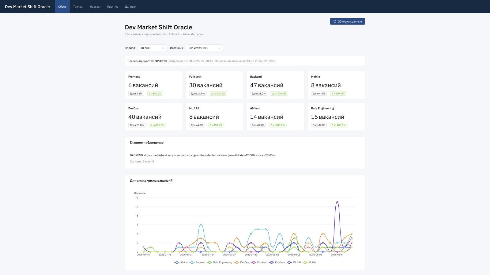
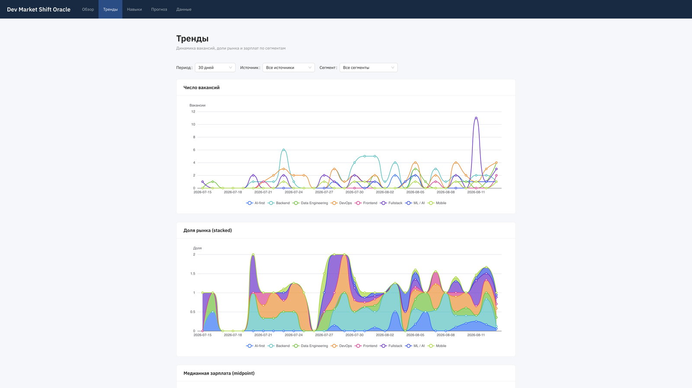
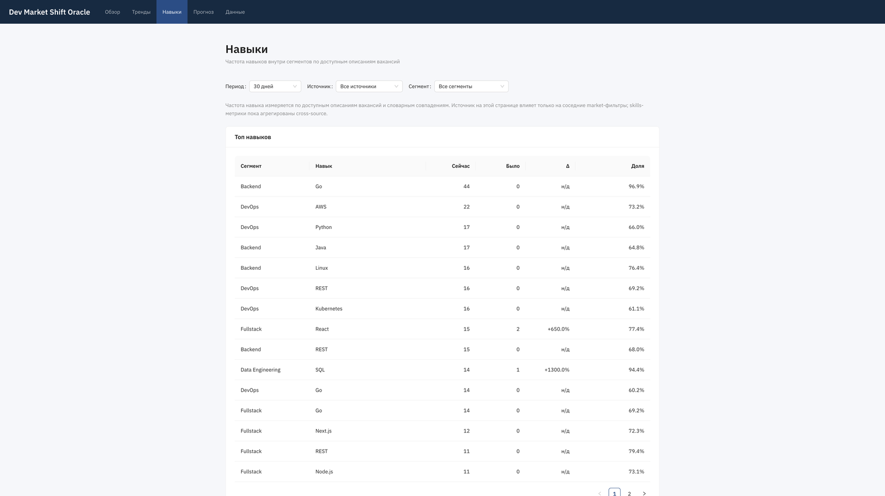
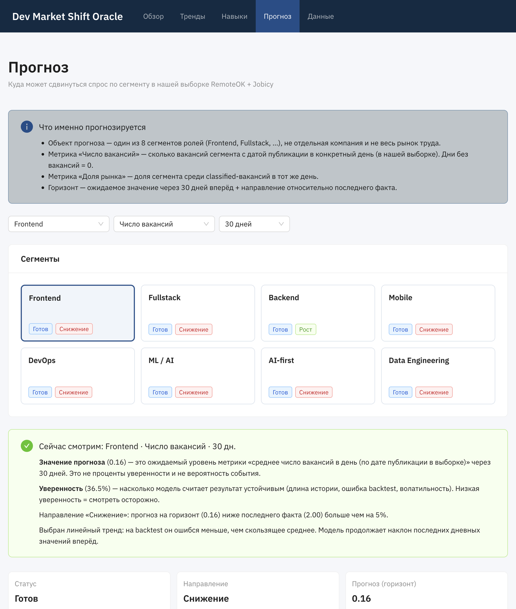
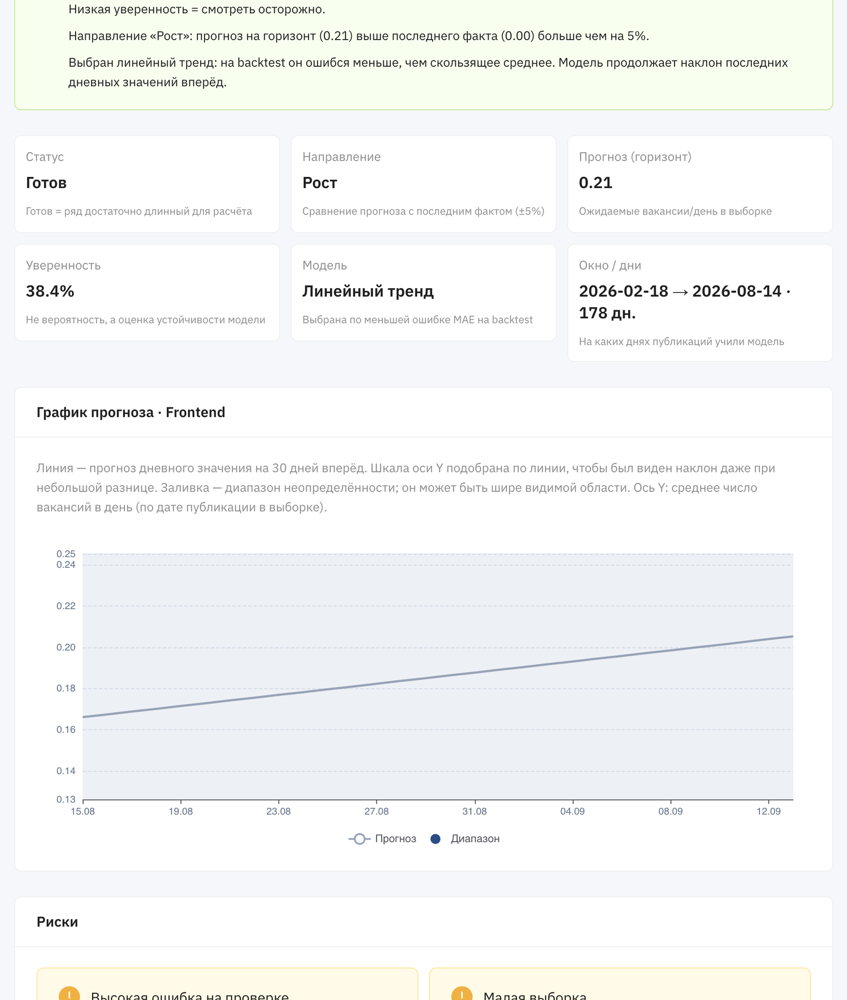
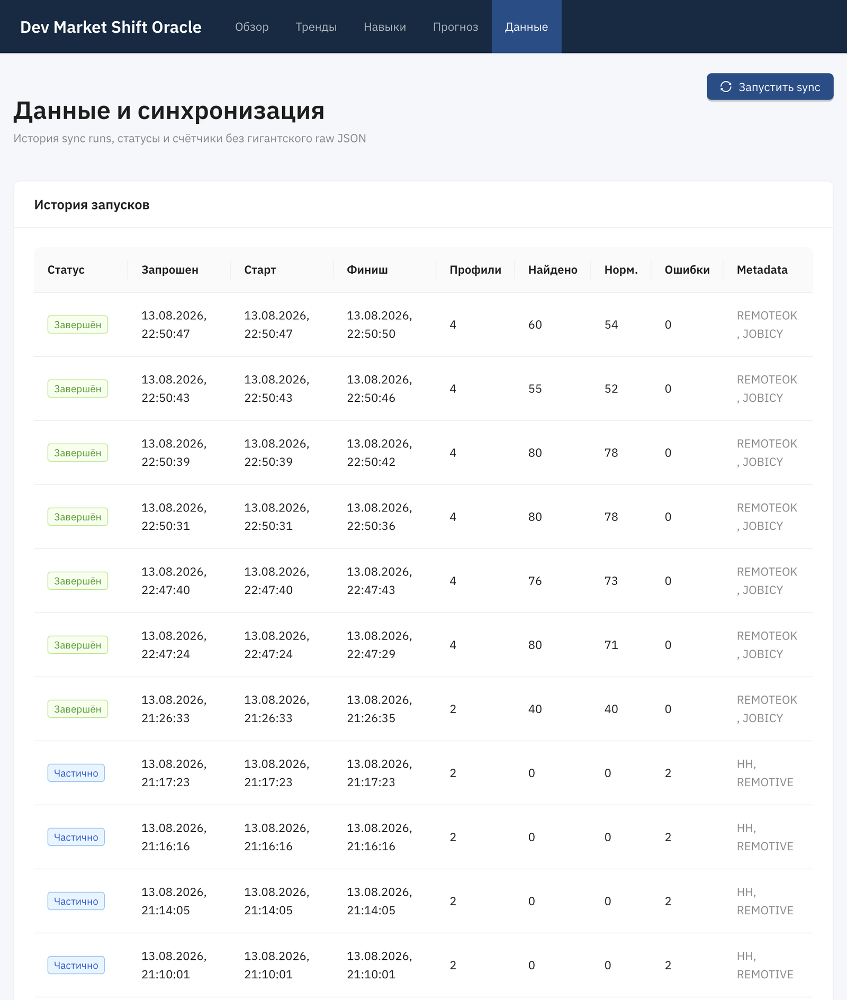
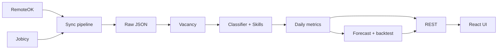

# Dev Market Shift Oracle

Приложение-предсказатель спроса на IT-роли по **реальной выборке вакансий**.

Не отвечает на кликбейт «умрёт ли frontend». Отвечает на более корректный вопрос:

> Как меняется спрос на frontend, fullstack и соседние инженерные роли, и какие навыки встречаются внутри каждого сегмента?

**Тема:** сдвиг спроса на IT-роли (frontend / fullstack / backend / mobile / devops / ML / AI-first / data engineering) по реальной выборке remote-вакансий. Не кликбейт «умрёт ли frontend», а измеряемая динамика сегментов и навыков внутри них.

Интерфейс на русском. Код, API и идентификаторы — на английском.

## Скриншоты

### Обзор

KPI по 8 сегментам, главное наблюдение и динамика вакансий.



### Тренды

Число вакансий, доля рынка и зарплаты по дням.



### Навыки

Частота навыков внутри сегментов по описаниям вакансий.



### Прогноз

Карточки сегментов, направление и уверенность.



График на 30 дней, KPI модели, риски и объяснение.



### Данные

История sync: статусы, счётчики, источники.



## Гипотеза

Рынок не «отменяет» frontend, а повышает требования к профилю: часть вакансий выглядит как hybrid frontend + backend / data / AI-tooling.

Это **гипотеза для проверки данными**, а не утверждение продукта. Приложение показывает доли, динамику и прогноз **по доступной выборке**, без маркетинговых выводов.

## Что измеряет продукт

- число вакансий по 8 сегментам в выборке RemoteOK + Jobicy;
- долю сегмента среди classified-вакансий (`UNCLASSIFIED` в долю не входит);
- частоту навыков по словарным совпадениям в title/description;
- краткосрочный прогноз дневного уровня метрики на 30 дней;
- уверенность, риски и backtest выбранной модели.

## Источники данных и ограничения

| Код        | Источник                                            | Роль                       |
| ---------- | --------------------------------------------------- | -------------------------- |
| `REMOTEOK` | [RemoteOK API](https://remoteok.com/api)            | Глобальные remote-вакансии |
| `JOBICY`   | [Jobicy API](https://jobicy.com/api/v2/remote-jobs) | Глобальные remote-вакансии |

Атрибуция: данные принадлежат RemoteOK и Jobicy; приложение их агрегирует.

**Почему не HeadHunter и не Remotive**

- Публичный `GET /vacancies` HeadHunter с апреля 2026 отвечает `403 forbidden` анонимным клиентам. Скрейпинг запрещён ТЗ.
- Remotive с многих сетей закрыт Cloudflare.

Оба кода остаются в схеме как неактивные (`isActive=false`).

**Ограничения выборки**

- Remote/global bias, не RU/CIS рынок.
- Rate limits и лимиты `SYNC_MAX_PROFILES_PER_RUN` / `*_DETAILS_LIMIT_PER_RUN`.
- Вакансия без зарплаты ≠ нулевая зарплата; coverage показывается отдельно.
- Короткая история ухудшает качество прогноза; дни без публикаций сегмента пишутся как `0` (факт отсутствия в выборке, не синтетический спрос).
- Прогноз описывает выборку, не всю профессию.

## Архитектура

```text
RemoteOK ──┐
           ├── apps/api (NestJS) ── Prisma ── PostgreSQL
Jobicy  ──┘         │
                    ├── Redis + BullMQ (sync)
                    ├── classify / skills / daily metrics / forecast
                    └── REST /api/v1
                              │
                    apps/web (Vite + React + Ant Design)
                    запросы только к /api/v1 (прокси Vite/nginx)
```



Источники **никогда** не вызываются из браузера.

## Стек и зачем он такой

| Слой         | Выбор                        | Зачем                                  |
| ------------ | ---------------------------- | -------------------------------------- |
| Monorepo     | pnpm workspaces              | Два приложения + тонкий `shared-types` |
| API          | NestJS + Prisma              | REST, очереди, схема БД                |
| Очередь      | Redis + BullMQ               | Один job `run-sync`                    |
| UI           | React + Ant Design + ECharts | Аналитическая панель, без MUI/Tailwind |
| Состояние UI | RTK Query                    | Polling sync, кэш overview/forecasts   |

Не используется: GraphQL, Kafka, Elasticsearch, auth, LLM для классификации/прогноза.

## Запуск

Нужны Node 20+, pnpm 9, Docker.

### Локально (рекомендуется для разработки)

```bash
cp .env.example .env
cp .env.example apps/api/.env

pnpm install
pnpm docker:up          # PostgreSQL + Redis
pnpm db:migrate
pnpm db:seed
pnpm dev:api            # http://localhost:3000  Swagger: /api/docs
pnpm dev:web            # http://localhost:5173
```

### Docker Compose «с нуля» (api + web + postgres + redis)

```bash
cp .env.example .env
pnpm docker:up:full
```

- UI: http://localhost:8080 (переменная `DOCKER_WEB_PORT`)
- API: http://localhost:3000 (переменная `DOCKER_API_PORT`; если порт занят локальным `pnpm dev:api`, задайте другой, например `DOCKER_API_PORT=3001`)
- Swagger: http://localhost:3000/api/docs (или тот же порт, что у `DOCKER_API_PORT`)

Nginx в контейнере web проксирует `/api/` на сервис `api`, браузер ходит только на UI.

Остановка: `pnpm docker:down`.

### Синхронизация

```bash
curl -s -X POST http://localhost:3000/api/v1/sync/runs \
  -H 'Content-Type: application/json' \
  -d '{"sourceCodes":["REMOTEOK","JOBICY"]}'
```

Статус: `GET /api/v1/sync/runs/<id>` (брать `id` из ответа POST).  
В UI то же самое: страницы **Обзор** / **Данные**, кнопка «Обновить данные».

После sync: classify → skills → daily metrics (с нулями в пустые дни) → forecasts.

Ручной пересчёт:

```bash
pnpm --filter @dev-market-oracle/api exec ts-node -r tsconfig-paths/register src/scripts/enrich-vacancies.ts
pnpm --filter @dev-market-oracle/api exec ts-node -r tsconfig-paths/register src/scripts/recalculate-analytics.ts
```

### Переменные окружения

См. [`.env.example`](.env.example). На старте API валидируется zod. Секреты не коммитить.

Ключевые: `DATABASE_URL`, `REDIS_HOST`, `SYNC_DEFAULT_SOURCE_CODES`, `SYNC_MAX_PROFILES_PER_RUN`, `SYNC_MIN_HISTORY_DAYS_FOR_FORECAST`, `SYNC_FORECAST_HORIZON_DAYS`.

## Как устроена база

PostgreSQL + Prisma (`apps/api/prisma/schema.prisma`). Слои данных:

| Слой          | Таблицы                                         | Зачем                                                      |
| ------------- | ----------------------------------------------- | ---------------------------------------------------------- |
| Справочники   | `Source`, `QueryProfile`, `Skill`               | Источники, поисковые профили, словарь навыков              |
| Сырые данные  | `RawSourceRecord`, `SyncRun`                    | JSON ответа API, URL, статус, hash; история запусков       |
| Нормализация  | `Vacancy`, `VacancySnapshot`                    | Одна вакансия на `(sourceId, externalId)`; снимок при sync |
| Классификация | `VacancyClassificationEvidence`, `VacancySkill` | Почему такой сегмент; какие навыки извлечены               |
| Метрики       | `DailyRoleMetric`, `DailySkillMetric`           | Дневные ряды по `publishedAt` (UTC)                        |
| Прогноз       | `Forecast`, `ForecastPoint`, `ForecastBacktest` | Горизонт 30 дней, точки, MAE/MAPE                          |

Ключи: вакансия уникальна по источнику + внешнему id; сырой JSON дедупится по `payloadHash`; дневная метрика сегмента — по дате + источнику + кластеру.

Полная схема: [`apps/api/prisma/schema.prisma`](apps/api/prisma/schema.prisma).

## Как устроен pipeline

1. **Ingest** — профили поиска (`QUERY_PROFILES`) ходят в RemoteOK/Jobicy с бэкенда.
2. **Raw** — JSON, URL, статус, hash в `RawSourceRecord`.
3. **Normalize** — upsert `Vacancy` по `(sourceId, externalId)`.
4. **Classify** — детерминированный keyword-классификатор, evidence в `VacancyClassificationEvidence`.
5. **Skills** — словарь алиасов → `VacancySkill`.
6. **Metrics** — `DailyRoleMetric` / `DailySkillMetric` по `publishedAt` (UTC-день). Пустой день сегмента = 0.
7. **Forecast** — rolling average vs linear trend; выбор по MAE backtest; иначе `INSUFFICIENT_HISTORY`.

## Алгоритмы

### Role classifier

- Сигналы: фразы > токены; title > skills > description.
- 8 кластеров + `UNCLASSIFIED` при слабом score.
- Hybrid FE+BE без слова fullstack → `FULLSTACK`.
- `AI_FIRST` только при сильном LLM/RAG/agent сигнале, не при «we use AI».
- Версия: `role-classifier-v1`.

### Skills

Словарь канонических навыков и алиасов (`Node` / `NodeJS` / `Node.js`). Частота = совпадения в доступном тексте, не «рост навыка на рынке».

### Forecast

- Цель: дневной `VACANCY_COUNT` и `MARKET_SHARE` на горизонт 30 дней.
- Кандидаты: скользящее среднее и линейный тренд.
- Выбор: меньший MAE на хвосте истории.
- Направление: UP / DOWN / STABLE (|Δ| < 5% от последнего факта).
- Confidence: длина истории, ошибка backtest, волатильность — **не** вероятность события.
- MAPE не считается при actual ≈ 0.
- Дни без вакансий сегмента в окне `publishedAt` заполняются нулями.

## Какие цифры должны сходиться

Это не «магические константы из ТЗ», а инварианты, которые можно проверить в UI / Swagger после sync.

1. **Доли сегментов.** На обзоре сумма `marketShare` у 8 сегментов ≈ **1** (с учётом округления). `UNCLASSIFIED` в долю не входит.
2. **Число вакансий за период.** Сумма `vacancyCount` по 8 сегментам = `coverage.classifiedVacanciesInPeriod` на `/market/overview`.
3. **Дни календаря.** В трендах у каждого сегмента есть точка на каждый UTC-день окна. День без вакансий = **0**, не пропуск.
4. **Прогноз.** На `/forecasts/:id` последнее `predictedValue` совпадает с KPI «Прогноз (горизонт)». Direction: UP/DOWN, если |прогноз − последний факт| ≥ 5%, иначе STABLE.
5. **История для прогноза.** Если дней с данными меньше `SYNC_MIN_HISTORY_DAYS_FOR_FORECAST` (14) — статус `INSUFFICIENT_HISTORY`, модель `none`.
6. **Sync-счётчики.** На странице «Данные»: нормализованных вакансий не больше найденных уникальных; `failedRequests` > 0 → статус `PARTIALLY_COMPLETED` или `FAILED`.
7. **Классификатор (тесты).** React → FRONTEND; React+Nest+PostgreSQL → FULLSTACK; PyTorch → ML_AI; LLM+RAG+agents → AI_FIRST; «we use AI» ≠ AI_FIRST. Проверка: `pnpm test`.

После `pnpm docker:up:full` или локального sync цифры в UI должны совпасть с `GET /api/v1/market/overview` и `GET /api/v1/forecasts`.

## API

Префикс `/api/v1`. Swagger: http://localhost:3000/api/docs

- `POST/GET /sync/runs`, `GET /sync/runs/:id`
- `GET /market/overview|trends|compare`
- `GET /skills/trending|matrix`
- `GET /forecasts`, `GET /forecasts/:id`, `GET /forecasts/:id/explain`
- `GET /health`, `GET /health/ready`

## Тесты и качество

```bash
pnpm lint
pnpm typecheck
pnpm test
pnpm build
```

Юнит: classifier (React→FRONTEND, React+Nest+PG→FULLSTACK, PyTorch→ML_AI, RAG/agents→AI_FIRST, casual AI ≠ AI_FIRST), алиасы навыков, MAPE/MAE, zero-fill календаря.

## Что сделано с помощью AI

- Планирование фаз, каркас monorepo, черновики сервисов и UI.
- Генерация тест-кейсов и ревью формулировок.

**AI не выдумывает метрики, классы вакансий и прогнозы.** Итог считает код по правилам выше на данных API.

## Trade-offs и что дальше

- HH/Remotive выключены, пока публичные API снова не откроются.
- Нет нормализации зарплат между валютами.
- Модель прогноза нарочно простая и объяснимая.
- Дальше: scheduled sync, больше истории, salary FX, опционально Adzuna, auth/saved reports.

## Self-review по ТЗ

| Требование                                                     | Статус                                                            |
| -------------------------------------------------------------- | ----------------------------------------------------------------- |
| Одна предметная область                                        | IT vacancy demand                                                 |
| ≥ 2 реальных источника                                         | RemoteOK + Jobicy (HH/Remotive задокументированы как недоступные) |
| БД: raw, normalize, forecasts, история                         | Prisma-схема + sync                                               |
| Список объектов прогноза                                       | 8 сегментов в UI                                                  |
| Карточка прогноза: value, confidence, risks, explain, backtest | `/forecast`                                                       |
| Понятный алгоритм                                              | README + `/forecasts/:id/explain`                                 |
| UI на русском, Ant Design                                      | 5 страниц                                                         |
| Нет моков в основном сценарии                                  | Живой sync                                                        |
| Нет LLM-классификации                                          | keyword dictionary                                                |
| Docker / local / env / migrate / seed                          | этот README                                                       |
| Quality gates                                                  | lint, typecheck, test, build                                      |
